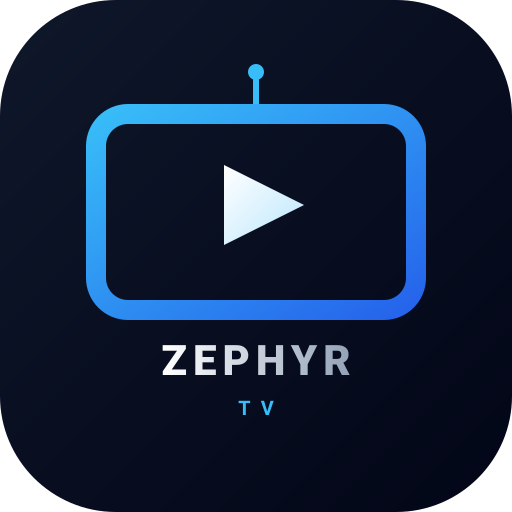

<h1 align="center">Zephyr TV guide</h1>

<b>English</b> · <a href="guida.md">Italiano</a>

This guide explains every feature of Zephyr TV, from the first setup to playing films, series and channels. It covers version 2.1 and later. To install the app, see the [README](../README.md#installation).

## Contents

1. [First start](#1-first-start)
2. [The Home screen](#2-the-home-screen)
3. [Using the remote](#3-using-the-remote)
4. [Favourites and apps](#4-favourites-and-apps)
5. [Continue Playing and what's playing](#5-continue-playing-and-whats-playing)
6. [Films and series](#6-films-and-series)
7. [A title's page](#7-a-titles-page)
8. [The player](#8-the-player)
9. [Choosing streams: quality, language, quick start](#9-choosing-streams-quality-language-quick-start)
10. [Content catalogs](#10-content-catalogs)
11. [Stremio add-ons](#11-stremio-add-ons)
12. [Nuvio plugins](#12-nuvio-plugins)
13. [Where channels, films and adult content show](#13-where-channels-films-and-adult-content-show)
14. [TV channels, TV guide and inputs](#14-tv-channels-tv-guide-and-inputs)
15. [Search](#15-search)
16. [Spotlight](#16-spotlight)
17. [Users and Trakt](#17-users-and-trakt)
18. [Adult content and the 18+ lock](#18-adult-content-and-the-18-lock)
19. [Appearance, wallpapers, weather and night](#19-appearance-wallpapers-weather-and-night)
20. [Screensaver](#20-screensaver)
21. [Your phone as a keyboard](#21-your-phone-as-a-keyboard)
22. [System: Home button, updates, backup](#22-system-home-button-updates-backup)
23. [Questions and answers](#23-questions-and-answers)

---

## 1. First start

On its first start, Zephyr TV asks two things:

1. **Films and series**: which catalog films and series come from.
   - **Nuvio Catalog (TMDB)**: titles, descriptions and pictures in the language of the TV, with no key needed.
   - **Cinemeta**: Stremio's free library, in English (TMDB can translate it, see [Spotlight](#16-spotlight)).
2. **Home button**: a guided setup makes the remote's Home button open Zephyr TV. Follow the steps on the screen.

You can change both later: the catalog in **Settings → Content → Content catalog**, the Home button in **Settings → System → Set up Home button**.

> [!TIP]
> On Android 13 and later, if the Home button switch is greyed out, follow the ADB step that Zephyr TV offers. The [README](../README.md#home-button-on-android-13-and-newer) explains how.

## 2. The Home screen

From top to bottom:

- **Top bar**: clock and weather, network, **Users**, **Search**, **TV inputs** and **Settings**. A red dot on the network means no internet; one on Settings means an update is ready.
- **Spotlight** (optional): a large film or series that changes every few seconds.
- **Favourites**: the row of your apps, with Zephyr TV's virtual apps (TV, Films, TV Series…).
- **Sections**: under Favourites, the rows of the app in focus. For example Continue Playing, YouTube's sections, the TV channels, the rows of films and series.

## 3. Using the remote

| Key | What it does |
|---|---|
| **OK** | Opens the selected app, card or row |
| **Hold OK** | On an app: its menu (move, remove, visible sections). On a card: remove it from the section |
| **Back** | Closes the panel or goes back a page, with focus on the row you left from |
| **Home** | Back to Zephyr TV. Hold it for the Google TV dashboard |
| **Number keys** | In the channel player: go to a channel. In PINs: type the digits |

## 4. Favourites and apps

**Settings → Favourites**:

| Row | What it's for |
|---|---|
| **Edit Favourites** | Move the apps in the row |
| **Sort apps** | Your order, or by use |
| **Apps in Favourites** | Show or hide each app. Hidden ones stay in *All apps* |
| **Favourites position** | Left or centre |
| **App names** | Always, on focus only, or never |
| **Icon style** | Monochrome or colour |
| **Lock layout** | A 4-digit PIN protects the settings and the layout. Apps still open |

Zephyr TV's **virtual apps** (TV, Films, TV Series, Adult Content, or one app per add-on) work like any other app: you can move them, hide them and put them back.

## 5. Continue Playing and what's playing

The first tile of Favourites shows:

- **What's playing**: what plays in another app (music, video), with its cover and progress. It needs to be allowed once: **Settings → Content → Show what's playing** explains how.
- **Continue Playing**: films and series you left halfway, from the apps that publish them and from Zephyr TV's player, with the next episode of a series.

| Row | What it's for |
|---|---|
| **Continue Playing apps** | Which apps the items come from |
| **Restore hidden items** | Brings back those removed with hold OK |

## 6. Films and series

Films and series come from the **catalogs** ([chapter 10](#10-content-catalogs)) and from the **add-ons** that have catalogs. By default they show in the **Films** and **TV Series** virtual apps, one row per catalog, and Search finds them.

The **streams**, the links that play, come from **Stremio add-ons** ([chapter 11](#11-stremio-add-ons)) and **Nuvio plugins** ([chapter 12](#12-nuvio-plugins)). With neither, you see the titles but can't play them.

## 7. A title's page

OK on a film or series card opens its page. At the top are its picture and logo; below:

- **Details**: rating, kind, year, genre, length, and whether you watched it.
- **Description**: shows at once, before the rest.
- **App bar**: the trailer and the streaming apps that have the title in your country (needs the TMDB key).
- **Films**: **Watch** (or **Resume from…**) and **Mark as watched**.
- **Series**: the seasons, with how many episodes you watched. In a season, Left and Right go to the season beside it. Each episode has its page with **Watch** and **Mark as watched**.

The page of a film or an episode looks for the streams when it opens. **Watch** shows **Looking for streams…**, then how many streams the sources have. When you select **Watch**, the player starts with the streams already found. The streams found stay ready for 90 seconds; after that, the player looks for them again. A TV channel's streams are found in the same way, when its card stays selected for a moment: a channel made of several (for example HD and SD) has them all ready.

## 8. The player

While it looks for streams, the player says where it is: **Loading the available streams…**, **Checking which sources work…**, then **Loading stream 1 of N…**. When a stream doesn't work, it tries the next one by itself.

| Key | Films and series | TV channels |
|---|---|---|
| **Left / Right** | Back and forward 10 seconds (held: faster) | The channel's previous and next stream |
| **Up / Down / OK** | Show the banner | Show the banner |
| **CH+ / CH−**, **⏭ / ⏮** | Next and previous episode | Next and previous channel |
| **Play / Pause** | Pause and play | Pause and play |
| **Hold OK**, **Menu** | Audio and subtitles | Audio and subtitles |

The banner has the **Previous episode**, **Play/Pause**, **Next episode**, **Audio**, **Subtitles** and **Stream** buttons. **Stream** lists all the streams found, grouped by quality from the highest, each with its source, to pick another one.

- **Series**: when an episode ends, the next one starts. At the last episode of a season, the player asks if you want to go on to the **next season**.
- **Audio**: each stream starts with the audio in the language of the TV, when it has it, else with its main track. A language you choose in **Audio** is for the stream you're watching.
- **Resume**: a film or episode left halfway starts again where you were, and shows in **Continue Playing**. It starts with the same stream as before, without looking for others. When that stream no longer plays, the player looks for a new one.

## 9. Choosing streams: quality, language, quick start

**Settings → Content**:

| Row | Default | What it does |
|---|---|---|
| **Stream choice** | Automatic | **Automatic**: the player picks and starts the best stream. **Manual**: **Watch** opens **Choose a stream**, one list of every add-on's and plugin's streams, each with its source |
| **Preferred quality** | Highest | **Highest**, 2160p, 1440p, 1080p, 720p or 480p. With 1080p, for example, the player tries 1080p and lower first, then the higher ones. 4K streams stay in the list |
| **Quick start** | On | Starts at once with the first working stream in the preferred quality and in the language of the TV, while the other sources keep looking. When no source has that quality, it waits for every source (up to 30 seconds) and starts the best one a step below. Not with **Highest**: then the player waits for every source and picks the best |
| **Streams in the TV's language first** | On | Tries the streams in the language of the TV first, then those that say no language, then those in other languages. With none in the language of the TV, it waits for every source before it plays one in another language |
| **Hide streams without a language** | Off | Hides the streams that don't say their language |
| **Hide films not yet released** | Off | Hides from Spotlight and the apps' rows the films that are not out at home yet in your country: still only in cinemas, or still to come. It uses TMDB (the key is necessary). A film is hidden only when TMDB says so for sure |
| **Subtitles always on** | Off | Off: each stream starts without subtitles, but those it forces (for example a line in another language). On: the subtitles in the language you picked last, else in the TV's language. A choice made in the player stays until you close it |

How **quality** and **language** are recognised:
- **Quality**: from the stream's name, for example 2160p/4K/UHD, 1440p/QHD, 1080p/FHD/Full HD, 720p/HD, 480p/SD.
- **Language**: from the stream's name, for example ITA, Italian, SUB-ITA, 🇮🇹, or "multi". When a plugin's stream says none, the plugin's declared language counts.
- **Check**: before it starts, the player checks all the streams at once and tries first those that really answer with a video. Expired links and web pages are skipped.

## 10. Content catalogs

**Settings → Content → Content catalog** is an ordered list of catalogs.

- **The first is the main one.** It gives the titles' details, descriptions, pictures and search. When it doesn't know a title, Zephyr TV asks the next catalogs.
- **The others** add their rows to Films and TV Series, in the list's order. The cards of titles the main one knows have its pictures, in the add-ons' rows and the search results too: a title looks the same everywhere.
- **Select a catalog** to move it up or down, or to remove it. One always stays.
- **Add a catalog** offers Cinemeta, Nuvio Catalog, catalogs you used before, or a **New address** (the manifest of an add-on with catalogs).

Under the list, the TMDB settings:

| Row | What it does |
|---|---|
| **Complete with TMDB** | Titles, descriptions and episodes in the language of the TV, from TMDB. It turns off by itself with Nuvio Catalog, which is in your language already |
| **TMDB API Key** | Your free key from themoviedb.org. Needed for Complete with TMDB, the app bar and Spotlight |
| **TMDB Language / Region** | The titles' language, which also counts as the TV's language for streams and audio |
| **Only services that have the title** | In the app bar, only the services that really have the title in your country |
| **Default apps for suggestions** | Which apps show in the app bar |

## 11. Stremio add-ons

**Settings → Extra features → Stremio add-ons**.

- **Add an add-on**: scan the QR code and paste the manifest address on your phone, or type it with the remote. You can mark it **Adult content (18+)** at once.
- **Each add-on** (with its icon) has a page with:
  - **On**: off, the add-on stays with its settings, but its content doesn't show.
  - **Update now**: reads its channels and catalogs again.
  - **Adult content (18+)**: marks it as adult ([chapter 18](#18-adult-content-and-the-18-lock)). An add-on that says it's adult always is.
  - **Move up / Move down**: the order of its rows and streams.
  - **Remove**.

An add-on can have TV channels, film and series catalogs, streams, or only some of them. Zephyr TV uses what it has.

## 12. Nuvio plugins

Nuvio plugins are small programs that find the streams of films, series and (when they say so) channels by themselves. Zephyr TV runs them apart from everything else, with access to the internet only. **Add only repositories you trust.**

**Settings → Extra features → Nuvio plugins**:

- **Add a repository**: from your phone (with the Adult content box) or with the remote. The address usually ends in `manifest.json`.
- **Each repository** has a page with:
  - **On**: the whole repository, on or off.
  - **A switch for each plugin**.
  - **Order of the plugins** (with two or more): OK on a plugin to pick it up, then OK on the place it goes. Their streams are asked for in this order.
  - **Options available**, under the plugins that have options of their own: switches, choices from a list, texts (a token or a cookie, for example, typed with the remote or pasted from your phone).
  - **Adult content (18+)**, **Move up / Move down**, **Update now**, **Remove**.

Sources that need WebSocket aren't supported: a plugin that uses one still gives the streams of its other sources.

Repositories update by themselves once a day. Plugins that declare only languages other than the TV's aren't asked (with **Streams in the TV's language first** on).

### Extensions

Extensions are Zephyr TV's own format to add films, series, TV channels, radio, videos and more. As Nuvio plugins
do, they run on the TV, apart from everything else and with access to the internet only. **Add only extensions you
trust.** **OMG Premium TV** is suggested in the list: OK installs it. Add your M3U playlists or Xtream accounts in its
**Options**, and the channels, films and series show in its app.

**Settings → Extra features → Zephyr Extensions**:

- **Add an extension**: the address of its `manifest-zephyrtv.json` (or of the folder it's in), pasted from your
  phone or typed with the remote; or its `.zip` file sent from your phone. Before installing it, Zephyr TV shows what
  it is, who wrote it and what it provides.
- **Each extension** has a page with **On**, **Options**, **Where it shows** (in its app, or in the collectors:
  Films, TV Series, TV Channels, Radio, Videos…), **Adult content (18+)**, **Move up / Move down**, **Update now** and
  **Remove**.
- An extension with content of its own has **its app** on the apps row, with its logo, once it has something to
  show.
- **Check for updates**: Zephyr TV also does it by itself, once a day.

### Hiding your IP

Add-ons, plugins and extensions ask the sites they read from your connection, so those sites see your IP, and so
does the server of each video. **Settings → Extra features → Hide your IP (Cloudflare WARP)**:

- **WARP for Zephyr TV**: all of what Zephyr TV does (the add-ons, plugins and extensions, and the player) goes through
  Cloudflare's free WARP network, and the sites see one of its addresses instead. Only Zephyr TV: the other apps stay
  as they are. Android asks once to allow the VPN and shows its key icon while it's on; another VPN can't be on at the
  same time.
- **The whole device: the 1.1.1.1 app**: Cloudflare's own app, for WARP on every app.

Some sites refuse VPN addresses: if one stops working, turn WARP off for a moment.

## 13. Where channels, films and adult content show

**Settings → Extra features → Virtual apps and integrations** (OK changes the choice):

| Row | Choices |
|---|---|
| **TV Channels** | **System TV app** (in the TV's own TV app, if it has one) · **Virtual app** (a Zephyr TV app) · **One app per add-on** |
| **Films** | **Virtual app** (the Films app) · **One app per add-on** · **Off** |
| **TV Series** | **Virtual app** (the TV Series app) · **One app per add-on** · **Off** |
| **Radio** | **Virtual app** (the Radio app, with every extension's radio stations) · **In each extension's app** · **Off** |
| **Adult Content** | **Virtual app** (the Adult Content app) · **One app per add-on** · **With the others** |

When you choose **Virtual app**, its app goes back into Favourites if you had taken it out. You can take it out again any time.

## 14. TV channels, TV guide and inputs

**Settings → TV & EPG**:

| Row | What it does |
|---|---|
| **TV inputs** | **Menu**: the **TV inputs** button opens a list of the inputs. **Favourites**: each input is an app |
| **Show connected inputs in Favourites** | Puts the inputs with a device plugged in (a console over HDMI, for example) in Favourites |
| **Channel logos (iptv-org)** | Logos for the channels that have none |
| **Update the channel logos** | Downloads the latest logos now |
| **TV guide (XMLTV)** | The address of a TV guide, to see what's on with a progress bar |

**Channel player**: CH+ and CH− change channel, Left and Right change stream, OK shows what's on now and next. The last channel watched shows in **Continue Playing**.

## 15. Search

The **Search** button in the top bar (hold OK: the TV's voice assistant):

- **Search**: type with the remote, or use the QR code to type on your phone.
- **Say it**: the words heard show in the box, then the search starts by itself.
- **Filters**:
  - **Type of content**: All, Films, Series or TV channels.
  - **Year** and **Genre**.
  - **Adult Content**: Show, Do not show, Only adult content. It shows only when 18+ is unlocked.
  - **Clear the filters**.
- **Without words**, the filters alone show the catalog's titles, for example "Films · 2010 · Action".

The results tile shows in Favourites at once, with "Searching “…”", and fills in as they come. Back, or holding OK on the tile, closes the search.

## 16. Spotlight

**Settings → Spotlight** (needs the TMDB key, see [chapter 10](#10-content-catalogs)):

| Row | What it does |
|---|---|
| **Spotlight shows** | Trending, popular, top rated, in cinemas, upcoming, on the air, or **My TMDB list** |
| **My TMDB list** | A public list of yours on themoviedb.org, pasted from your phone |
| **Content type** | Films and series, films only or series only |
| **Next title every** | How many seconds before the next title, or never |

Spotlight's buttons open the title's page, the trailer or a streaming app.

## 17. Users and Trakt

The **Users** button in the top bar (it shows the initial of the user in use):

- **Pick a user**: each has their own history, watched marks and Continue Playing.
- **Settings** (behind the layout lock, when it's on):
  - **Add user**, and for each user **Rename** and **Remove**.
  - **Connect Trakt**: keeps watched titles and progress in step with your Trakt account.

## 18. Adult content and the 18+ lock

- **Adult add-ons and plugins**: marked by you, or saying so themselves.
- **18+ lock** (**Users → Settings**, optional): choose a PIN. While it's locked, adult content shows nowhere: apps, rows, search, streams.
- **Unlock 18+** (**Users** menu): with the PIN, the content shows for **2 hours** or, with **Unlock for → Until you lock it**, until you choose **Lock 18+**.
- The lock comes back by itself when the TV goes to **standby**, turns off or restarts.
- **Where it shows**: see **Adult Content** in [chapter 13](#13-where-channels-films-and-adult-content-show).

## 19. Appearance, wallpapers, weather and night

**Settings → Appearance & wallpapers**:

| Row | What it does |
|---|---|
| **Theme** | Light, Dark, Glass (see-through cards) or Automatic |
| **Light / Dark mode wallpaper** | The built-in wallpapers, **Add from phone…**, a photo folder, or Spotlight's pictures |
| **Photo fade** | A light shade that keeps the rows readable |
| **Folder photo changes** | How often a folder's photo changes |
| **Weather**, **Weather units**, **Weather location** | The weather under the clock, in °C or °F, for where you are or a city |
| **Clock** | 12 or 24 hours |
| **Night mode**, **starts at**, **ends at** | In those hours Home gets darker and Spotlight stops |

## 20. Screensaver

**Settings → Screensaver**:

- **Screensaver**: landscape paintings (downloaded only if you choose them), a folder of your photos, or Spotlight's pictures with their titles.
- **Test screensaver**: starts it now.
- **Screensaver timing**: opens Android's settings to choose when it starts.

## 21. Your phone as a keyboard

Many screens show a **QR code**: scan it with your phone, which must be on the same Wi-Fi as the TV. A page opens where you type or paste (add-on and repository addresses, the TMDB key and list, the TV guide, searches) or send photos and backups.

The page works only while that screen is open on the TV, and what you send goes only from your phone to the TV.

## 22. System: Home button, updates, backup

**Settings → System**:

| Row | What it does |
|---|---|
| **Set up Home button** | The first start's guided setup again |
| **Home button** | The service that makes the Home button open Zephyr TV |
| **Default launcher** | Sets Zephyr TV as Android's Home |
| **Updates** | Looks for and installs new versions. You can get the **betas** too |
| **Backup and restore** | Saves the settings to your phone and restores them. The file holds the TMDB key and the add-ons' addresses: keep it private |
| **Recent problems** | What went wrong lately. For a stream that fails: its source, its server and what the server sent |
| **Guide** | This guide, on the TV, chapter by chapter |
| **About** | Version, licences, data sources |

## Phones and tablets

Zephyr TV works on Android phones and tablets too, with a finger:

- **Home**: swipe up and down to scroll it, to the side to scroll a row; tap an app to show its rows, and again to
  open it (an app with no rows opens at once); pull down from the top to read its rows again. Swipe Spotlight to
  see the title before or after.
- **Panels**: ← at the top left goes to the page before, ✕ at the top right closes them; a tap beside a panel closes it too.
- **Player**: tap for the information and the buttons; double-tap left or right to go back or on 10 seconds; drag
  the progress bar; swipe up or down on the left for the brightness, on the right for the volume, in the middle to
  change channel; pinch to fill the screen or fit it; 🔒 locks the controls; leave the player while a video plays
  and it goes on in a small window.
- **Share** on a title's page sends a link: Zephyr TV opens it on another phone or tablet. A link shared to Zephyr
  TV (a Stremio add-on's `manifest.json`, a `stremio://`, `nuvio://` or `ztv://` link) is added once you confirm it.
- What a TV does with a QR code and your phone is done on the device itself: its keyboard, its file picker.

## 23. Questions and answers

<b>A film says "No stream available"</b>

- Check that at least one add-on or plugin that gives streams is on (chapters 11 and 12).
- With **Streams in the TV's language first** on, plugins for other languages aren't asked.
- Open **System → Recent problems**: for each stream that failed it shows the source and what the server answered. Expired links, web pages and blocked servers depend on the source, not on Zephyr TV.

<b>A stream starts in a lower quality than I'd like</b>

With **Quick start** on and a preferred quality, the player starts with the first working stream in that quality. With **Highest** it waits for every source and picks the best. You can always switch with the player's **Stream** button.

<b>The audio is in the wrong language</b>

Each stream starts with the audio in the language of the TV, when the stream has it. Otherwise, choose the language in the player's **Audio** (or hold OK): it's for the stream you're watching.

<b>I can't see adult content</b>

When the **18+ lock** is on, unlock it from the **Users** menu. It locks again by itself on standby.

<b>The Home button still opens Google TV's Home</b>

Check **System → Home button**. When the switch is greyed out (Android 13+), follow the setup's ADB step, explained in the [README](../README.md#home-button-on-android-13-and-newer).

